# Menu do n.privacy: diagnóstico e proposta (14/10/2026)

Estudo pedido depois da reorganização por áreas (#377), que ainda não resolveu o menu. Este documento não muda
código. Ele traz o diagnóstico do menu atual, três alternativas com protótipo navegável e uma recomendação. A
decisão é do dono.

Método: skill Impeccable, comando `critique`, no modo Operate (app de trabalho). Duas avaliações isoladas: (A)
revisão de design sobre o código e as capturas e (B) detector mais medição no navegador. Somam-se uma pesquisa de
referência e as medições próprias deste estudo. Não há `PRODUCT.md` no repositório; o contexto veio de `DESIGN.md`,
`design.md`, `AGENTS.md` e do código (o carregador da skill rodou e avisou disso).

Base: `origin/main` em `742b521`. Capturas com o build local (`npm run build --prefix frontend`), servido em
`127.0.0.1:8787`, API simulada como em `frontend/e2e/n360.spec.js` e Chromium headless. Nenhum dado real: projeto
"Programa LGPD Exemplo".

## 1. O menu de hoje

Montagem: `frontend/login.html` (o `<nav id="sidebar">` é um só para n.360, n.iso e n.privacy),
`organizarMenuPrivacy` em `frontend/src/produto.js` (move itens e troca rótulos só no n.privacy),
`frontend/src/selos-menu.js` (selos), `toggleGroup` em `frontend/src/globals.js` (acordeão) e
`.sidebar-nav-destaque` e `.sidebar-selo` em `frontend/src/style.css`.

Inventário medido no DOM, por papel ([`atual/inventario-menu.json`](menu-privacy/atual/inventario-menu.json)):

| | Consultor | Admin da consultoria | Gestor do cliente (org_admin) |
|---|---|---|---|
| Itens soltos no 1º nível | 6 (Meus pedidos, Encarregado, DSAR, Terceiros, Incidentes, Assistente) | 6 | 6 |
| Rótulos de grupo | 4 (Mapear e avaliar, Governança e provas, Implantação, Sistema) | 4 | 2 |
| Destinos no menu | 15 | 15 | 14 |
| Visíveis sem clicar | 9 de 15 | 9 de 15 | 9 de 14 |
| Opções no 1º nível (itens + grupos) | 10 | 10 | 8 |
| Links no rodapé | 2 | 3 (mais "Abrir este projeto no n.iso") | 2 |
| Paradas de Tab na barra | 23, sendo 7 invisíveis | | |

| Consultor, 1440 | Abrir "Governança e provas" fecha "Mapear e avaliar" | Barra recolhida |
|---|---|---|
| 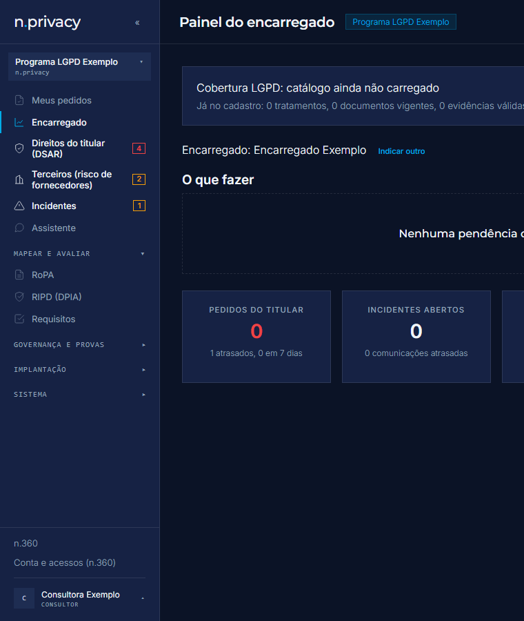 |  | 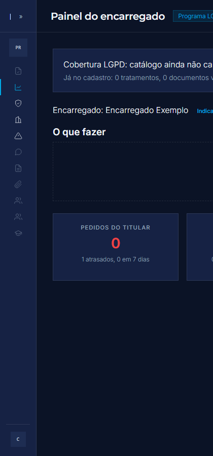 |

| Cliente (org_admin), 1440 | Consultor, 1024x768 | Consultor sem selos |
|---|---|---|
| 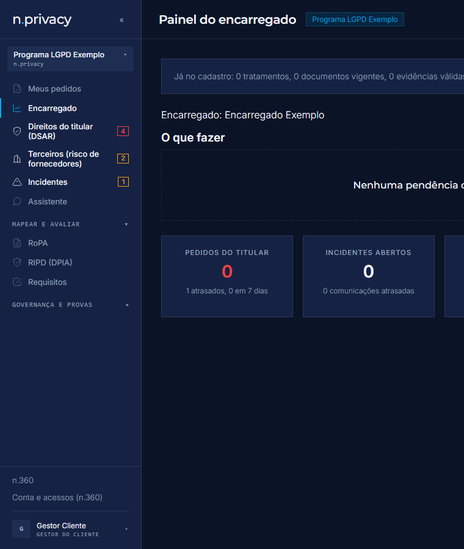 | 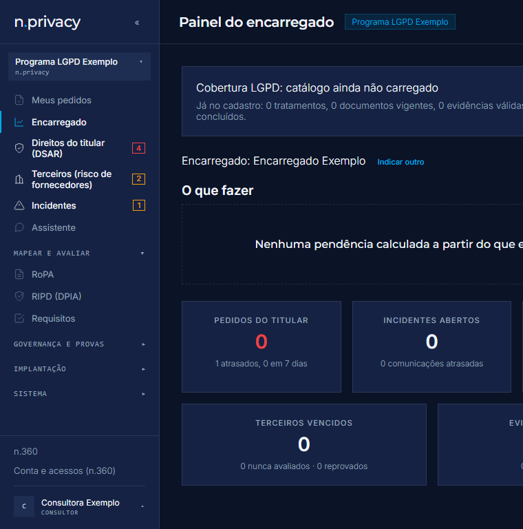 | 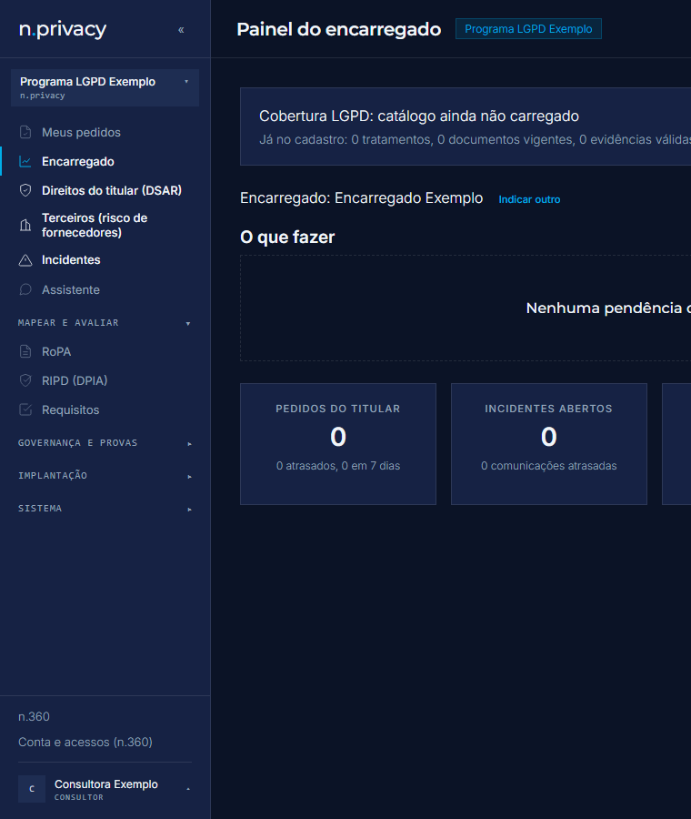 |

Também em [`atual/`](menu-privacy/atual/): `consultoria_admin-1440-selos.png` e `org_admin-1024-selos.png`.

## 2. Placar da critique

Notas da avaliação A (design), revisadas na síntese com as medições da B.

| # | Heurística | Nota | Problema principal |
|---|---|---|---|
| 1 | Visibilidade do status | 2 | Selos e `aria-current` existem, mas os selos somem na barra recolhida, só recarregam ao voltar ao painel do Encarregado e a "Trilha de Logs" nunca fica ativa (o router procura `nav-audit`, `router.js:37`; o id é `nav-audit-trail`). Trocar de aba dentro de Titular não muda o item ativo. |
| 2 | Linguagem do usuário | 2 | Siglas entre parênteses ("Direitos do titular (DSAR)", "RIPD (DPIA)"), item "Governança" dentro do grupo "Governança e provas", "Encarregado" é papel e não lugar, "Meus pedidos" e "pedidos do titular" usam a mesma palavra para coisas diferentes. |
| 3 | Controle e liberdade | 2 | O acordeão fecha o grupo aberto, inclusive o do item ativo. |
| 4 | Consistência | 2 | Grupos de 1 item (Implantação, Sistema); o mesmo ícone em Partes e Governança; peso visual fixo por classe, não por estado. |
| 5 | Prevenção de erro | 3 | O menu só mostra o que o papel alcança, e a trava é do servidor. |
| 6 | Reconhecer em vez de lembrar | 2 | 6 de 15 destinos ficam escondidos; Consentimentos e Prazos legais não têm entrada (são abas de Titular); a barra recolhida não tem nome em nenhum ícone. |
| 7 | Flexibilidade e eficiência | 1 | Itens são `div role="link"` sem `href` (não abrem em nova aba); ir de RoPA a Documentos custa 2 cliques e fecha o RoPA. |
| 8 | Estética e minimalismo | 3 | Visual quieto e na marca; ruído dos rótulos em 2 linhas e de 4 grupos para 9 itens. |
| 9 | Recuperação de erros | n/a | O menu não produz erro (a falha do selo é silenciosa por decisão). |
| 10 | Ajuda e documentação | 1 | Siglas sem explicação; o número do selo não diz o que conta para quem enxerga. |
| **Total** | | **18/36** | **50%: aceitável, precisa de trabalho** |

Carga cognitiva: 5 falhas em 8 no checklist (muitas opções, navegação escondida, jargão, padrão inconsistente,
ponte de memória). Acima de 4 é carga alta.

Avaliação B (detector e navegador): ver a seção 3.1.

## 3. Diagnóstico

### 3.1 Evidência do detector e do navegador

**Detector (CLI).** `impeccable detect --json frontend/login.html`: saída 2, 19 avisos. Destes, 12 são do menu:

| Regra | Quantos | Onde |
|---|---|---|
| `layout-transition` (max-height) | 9 | `.sidebar-group`, `style.css:220`, um por grupo |
| `cramped-padding` | 1 | `.sidebar-logo`, `style.css:176`: a borda da banda de 64px; intencional |
| `undersized-ui-text` (9px) | 1 | `.sidebar-user-role`, `style.css:238` (papel no cartão da pessoa) |
| `clipped-overflow-container` | 1 | `.sidebar { overflow: hidden }`, `style.css:169`: corta o `.tooltip` se um dia ele for usado na barra recolhida |

Os outros 7 são do resto da página: painel de contexto, `overused-font` (Inter e Montserrat são da marca, falso
positivo) e `dark-glow` do accent (fora do menu). O build (`frontend/dist/login.html`) dá os mesmos 19 e mais um
`side-tab` fora do menu.

**Overlay no navegador.** Injetar `detect.js` pela URL do live-server falhou no Chromium headless
(`net::ERR_FAILED`; o curl baixa o arquivo normalmente). Injetando o conteúdo do mesmo arquivo, o detector rodou
na página do consultor e achou 45 padrões. Os 30 de `ai-color-palette` são o accent da marca; na barra só o ponto
de "n.privacy" é ciano. O live-server foi parado no fim.

**Medições no navegador (consultor, 1440x900).**

- Tab: de 23 a 25 paradas na barra, conforme o ponto de partida. Em todas as medições, 7 caem em item de grupo
  fechado (altura 0). Focar não abre o grupo, e a árvore de acessibilidade expõe esses 7 links como visíveis.
- Barra recolhida: 16 links `div role="link"` sem nome, sem `aria-label` e sem `title`; o cartão da pessoa vira
  `button "C"`. O botão de recolher mantém o nome ("Expandir navegação").
- `aria-expanded` acompanha o grupo (false, true, false), mas o rótulo não tem `aria-controls`.
- Contraste sobre `--surface`: rótulo de grupo e item comum 6,08:1, selo âmbar 7,26:1. **O selo vermelho
  (`#ef4444`, 11px) fica em 4,14:1 e reprova o AA** (4,5:1 para texto pequeno).
- Alvos: item comum 32px, item em destaque 45px (é o rótulo em duas linhas), rótulo de grupo 36px e botão de
  recolher 24x24px.
- Selo: `role="img"` com `aria-label`. O nome do link fica "Direitos do titular (DSAR) 4 pedidos vencidos ou a
  vencer em 7 dias". Na barra recolhida o selo sai da árvore: o aviso de atraso some para quem enxerga e para quem
  usa leitor de tela.

O detector não pega os três problemas mais graves do menu: Tab em grupo fechado, links sem nome na barra
recolhida e o contraste do selo vermelho. Eles saem da medição no navegador.

**Detector sobre os protótipos.** Cada um dos três protótipos tem 3 avisos: `cramped-padding` na banda da marca,
igual ao app, e `overused-font` duas vezes, pela fonte da marca. Os dois são falsos positivos. O texto abaixo de
11px que o app tem no cartão da pessoa e no seletor de projeto já está corrigido nos protótipos.

### 3.2 Problemas, em ordem de prioridade

1. **[P1] Dois princípios de organização misturados.** O primeiro nível junta o painel, três filas com prazo,
   o Assistente e "Meus pedidos"; os grupos juntam artefatos ("Mapear e avaliar") e o cadastro compartilhado com
   o n.iso ("Governança e provas"). Quem procura uma tela precisa saber antes se ela é "fila" ou "artefato". O
   RoPA, peça central do programa (art. 37), fica no segundo nível e esmaecido (`--text-dim`, ícone a 50%), enquanto
   as filas aparecem em branco e negrito o tempo todo, com ou sem pendência.
2. **[P1] Acordeão.** `toggleGroup` fecha todos os grupos e abre um. A jornada do consultor cruza três blocos
   (RoPA e RIPD em um, Terceiros no topo, Documentos e Evidências em outro). Abrir "Governança e provas" esconde o
   RoPA. O menu inteiro aberto cabe na tela (o consultor tem 15 destinos), então o acordeão só esconde.
3. **[P1] Grupo fechado continua no teclado.** `.sidebar-group` fecha com `max-height: 0`: os 7 itens dos grupos
   fechados (Documentos, Evidências, Partes, Governança, Treinamento, Importar programa, Trilha de Logs) seguem no
   Tab. Medido: 23 paradas, 7 invisíveis. O rótulo do grupo tem `aria-expanded`, mas não tem `aria-controls`.
4. **[P1] Barra recolhida sem nome.** `.sidebar.collapsed .sidebar-nav-text { display: none }` tira o texto da
   árvore de acessibilidade: nenhum link tem nome (medido: 0 links com nome "Direitos do titular"). Não há
   tooltip (a classe `.tooltip` existe, nenhum item usa). Os rótulos de grupo somem, então RoPA, RIPD e Requisitos
   ficam inalcançáveis se o grupo estiver fechado. Os selos somem (`.sidebar.collapsed .sidebar-selo`). Partes e
   Governança têm o mesmo ícone.
5. **[P2] Rótulos.** "Governança" dentro de "Governança e provas". "Terceiros (risco de fornecedores)" e "Direitos
   do titular (DSAR)" quebram em duas linhas e saem do ritmo de 32px. "Mapear e avaliar" põe Requisitos (cobertura
   da lei) junto do inventário. "Implantação" e "Sistema" são grupos de um item.
6. **[P2] Selo.** O número é o total que exige atenção; a cor diz se algum já atrasou. "4" em vermelho quer dizer
   "4 a tratar, pelo menos 1 atrasado", e só a cor separa isso de "4 a tratar, nenhum atrasado". O leitor de tela
   recebe o texto completo; quem enxerga, não. O mesmo âmbar serve para "a vencer" (titular) e "sem avaliação"
   (terceiros). O painel não tem selo. O selo vermelho fica em 4,14:1, abaixo do AA, e some na barra recolhida.
7. **[P2] Uma tela, dois itens, quatro abas.** "Direitos do titular" e "Incidentes" abrem a mesma tela (`titular`)
   em abas diferentes; a tela ainda tem Consentimentos e Prazos legais, sem entrada no menu. Trocar de aba pela tela
   não atualiza o item ativo (`escolherAbaTitular` chama `render`, não `navigate`).
8. **[P3] Utilitários no lugar de trabalho.** "Meus pedidos" é a primeira linha, acima do painel; "Assistente"
   fica entre as filas e os grupos.

Onde o fluxo do consultor quebra (contado no menu de hoje, partindo do painel):

| Tarefa | Hoje | Observação |
|---|---|---|
| RoPA → RIPD | 1 clique | Mesmo grupo |
| RIPD → Terceiros | 1 clique | Terceiros no topo |
| Terceiros → Documentos (anexar DPA) | 2 cliques | Abre o grupo; o RoPA some |
| Documentos → Evidências | 1 clique | |
| Evidências → RoPA | 2 cliques | Reabre "Mapear e avaliar" |
| Painel → Consentimentos | 2 cliques | Sem item; DSAR e depois a aba |

### 3.3 O que funciona e deve ficar

- As filas com prazo legal estão à vista e o número vem do servidor (`GET /projects/:id/encarregado`), com
  `aria-label` completo.
- O menu mostra só o que o papel alcança (Implantação e Sistema somem para o cliente); a trava é do servidor.
- `aria-current="page"`, Enter e Espaço tratados, `:focus-visible` em accent e o grupo do item ativo abre sozinho.

## 4. Referências

Pesquisa limitada (23 buscas e leituras). Para a maioria dos produtos, o menu do app autenticado não tem
documentação pública; o que não deu para confirmar está marcado.

| Produto | Padrão de navegação | Situação | Fonte |
|---|---|---|---|
| Transcend | Menu lateral por produto ou módulo (DSR Automation, Data Inventory, System Discovery, Classification, Preference Store...). A reorganização de nov/2023 renomeou módulos e publicou nota de mudança. | Verificado em parte | https://docs.transcend.io/docs/overview/nav-bar-update |
| DataGrail | Painel de privacidade que reúne indicadores e tarefas de todos os módulos, com prazo em faixas (no prazo, vence logo, vencido) e tarefas por papel. Os contadores ficam no painel. | Painel verificado; menu lateral e tela de entrada não verificados | https://docs.datagrail.io/docs/overview/privacy-dashboard |
| OneTrust | Anúncio de "Workspaces Navigation" e navegação lateral própria por área (Winter '24). | Só o anúncio | https://www.onetrust.com/news/onetrust-winter-release-24/ |
| Termly | DSAR dentro de Consent Management. | Não verificado (página deu 403) | https://support.termly.io/en/articles/7904723-how-do-i-set-up-a-dsar-form-for-my-website-visitors |
| Osano | Categorias do help center sugerem módulos (Data Subject Rights, Data Mapping, Assessments, Vendor Risk). | Não verificado (404) | https://docs.osano.com/hc/en-us/categories/21084674880020-Products |
| Securiti, TrustArc, Privacy Tools | Só material comercial; TrustArc tem "Difficult Navigation" entre as queixas no G2; Privacy Tools fala em "painel centralizado" para o DPO. | Não verificado | https://www.g2.com/products/trustarc/ , https://privacytools.com.br/?p=12689 |
| NN/g | Menu vertical à esquerda serve arquitetura larga; rótulo sempre visível, nunca só ícone; não esconder a navegação no desktop; navegação local mostra as telas irmãs da seção. | Verificado | https://www.nngroup.com/articles/vertical-nav/ , https://www.nngroup.com/articles/local-navigation/ |

O que se tira disso, sem copiar visual de ninguém:

- O padrão confirmado é agrupar por área de trabalho com nomes de objeto do domínio (pedidos do titular,
  inventário, terceiros, incidentes). Não achei produto que organize o menu por fase do programa nem um menu por
  papel; o papel filtra o que cada um vê.
- Painel do DPO como agregador tem respaldo (DataGrail, Privacy Tools); como substituto do menu, não.
- Contador de prazo aparece no painel; não achei fonte verificada com selo no menu lateral. Se ficar no menu, que
  seja pouco e diga o que conta.
- Com ~15 telas, menu vertical com seções rotuladas e tudo visível é o caminho de menor surpresa.

## 5. Alternativas

Os três protótipos são HTML estático, abrem direto no navegador e são navegáveis: clicar no item troca a tela, o
botão `«` recolhe a barra, o cartão da pessoa abre o menu de conta e o controle no canto troca papel e selos. Tokens
copiados do `:root` de `frontend/src/style.css`, sistema quadrado, sem itálico e sem emoji; os ícones são os do
menu atual (Governança e Consentimentos ganharam ícone próprio). Parâmetros: `?papel=org_admin`, `?selos=0`,
`?rail=1`, `?conta=1`, `?tela=ropa`.

O que vale para as três (e pode entrar já, independente da escolha):

- Rótulos de uma linha, nome do objeto antes da sigla: "Tratamentos (RoPA)", "RIPD", "Pedidos do titular",
  "Cobertura da LGPD" (hoje Requisitos), "Papéis e comitê" (hoje Governança, só no n.privacy), "Pessoas, áreas e
  sistemas" (hoje Partes).
- Selo com forma além da cor. Com pendência, contorno âmbar (7,26:1). Com algo atrasado, fundo vermelho e número
  em `--accent-ink` (5,03:1). O selo vermelho de hoje, só no contorno, fica em 4,14:1 e reprova o AA. O painel ganha
  selo só com os atrasados. Na barra recolhida o selo vai para o canto do ícone.
- Barra recolhida com nome: o texto fica visualmente escondido, não `display: none`, e aparece ao passar o mouse
  ou focar.
- "Meus pedidos" vira "Minhas aprovações" e vai com "Trilha de logs" para o menu de conta (o cartão da pessoa), que
  já existe (`#account-menu`). Os dois continuam no n.360.
- Itens viram `<a href>` em lista (`ul`/`li`): abrem em nova aba e o leitor de tela anuncia a lista.

### A. Ciclo do programa, tudo à vista

[Protótipo](menu-privacy/alternativa-a-ciclo.html)

Painel no topo e quatro seções fixas na ordem em que o programa anda: Mapear (Tratamentos, Pessoas áreas e
sistemas, Terceiros, Importar programa para a equipe), Avaliar (RIPD, Cobertura da LGPD), Responder (Pedidos do
titular, Incidentes, Consentimentos) e Provar (Documentos, Evidências, Treinamento, Papéis e comitê). O
Assistente fecha a lista. Nenhuma seção recolhe: os rótulos de seção são títulos, não botões.

| 1440x900 | 1024x768 | Cliente, barra recolhida |
|---|---|---|
| 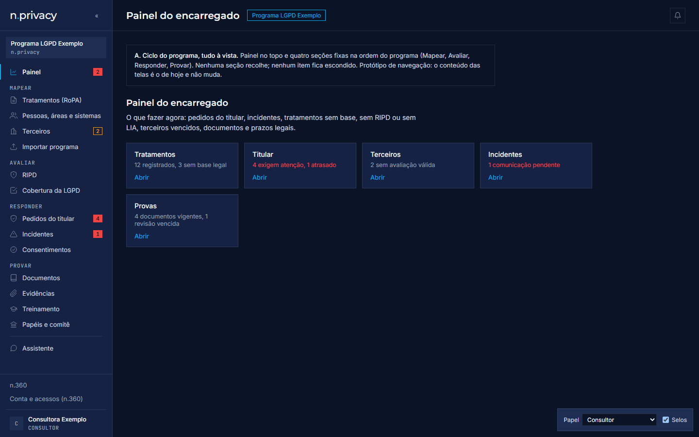 | 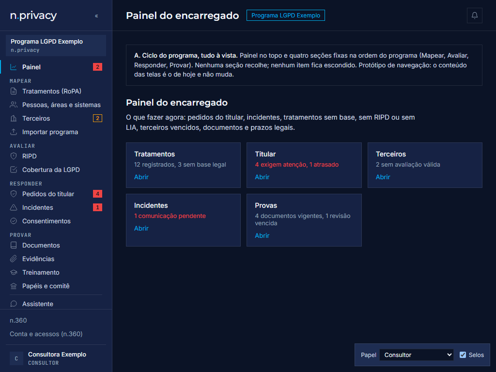 | 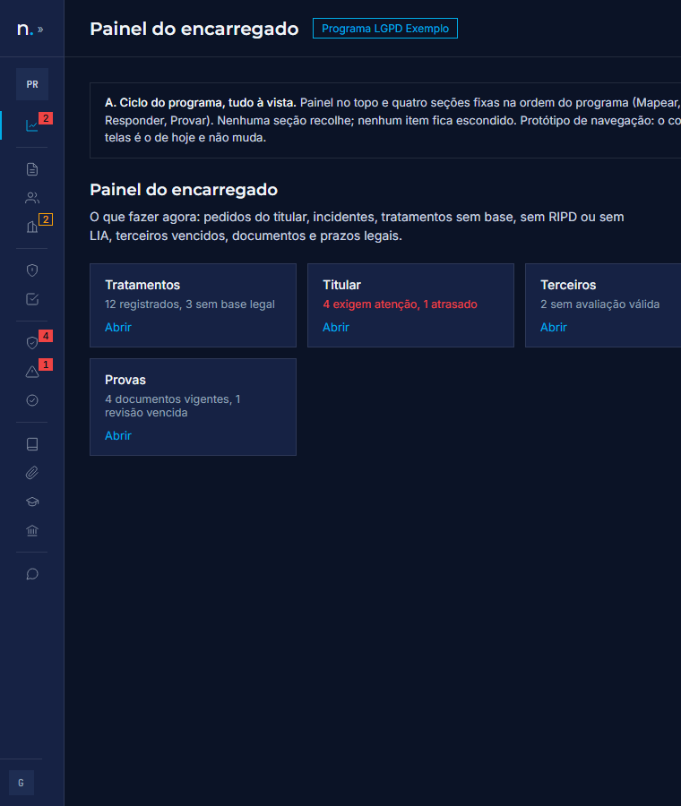 |

- Itens por nível: 1 painel + 4 seções com 4, 2, 3 e 4 itens + Assistente. Consultor 15 destinos, cliente 14, todos
  visíveis; nenhum clique para abrir grupo.
- Selos: Painel (atrasados), Terceiros, Pedidos do titular, Incidentes.
- Cliente e consultor veem a mesma ordem; o cliente não vê Importar programa nem Trilha de logs.
- A 1024x768 cabe com densidade compacta (itens de 28px abaixo de 820px de altura; medido: 517px de conteúdo para
  514px de área, 3px de rolagem). Com mais um item, rola.
- Custo: baixo a médio. `produto.js` (`organizarMenuPrivacy` cria as quatro seções e move os itens; os grupos de
  hoje ficam vazios e já somem pela regra existente), `login.html` (um item `nav-consentimentos` em `SO_PRIVACY`,
  que abre `titular` na aba consentimentos), `style.css` (título de seção, selo preenchido, rail com nome),
  `selos-menu.js` (selo do painel), `router.js` (ativo de Consentimentos e o `nav-audit-trail`), `globals.js`
  (`escolherAbaTitular` acerta o ativo; `updateHeaderUser` leva Meus pedidos e Trilha para o menu de conta só no
  n.privacy). Testes: `frontend/test/casca-menu.test.js` (casos do n.privacy reescritos; os do n.iso ficam),
  `selos-menu.test.js`, `produto.test.js`, `frontend/e2e/n360.spec.js` (hoje procura "Mapear e avaliar" e
  "Governança e provas").
- Risco: baixo. Só o n.privacy muda; o acordeão continua no n.iso porque as seções do n.privacy não são
  `.sidebar-label` clicáveis. O que há de errado no n.iso (Tab em grupo fechado, rail sem nome) fica registrado e
  só muda se o dono quiser estender.
- Para quem já usa: as filas descem da primeira posição para a seção Responder, mas ficam à vista e com selo; tudo
  o que estava escondido aparece.
- Ressalva honesta: a pesquisa não confirmou nenhum produto que agrupe por fase. Aqui a fase é só o título da
  seção; os itens têm nome de objeto, que é o padrão confirmado.

### B. Áreas no topo, menu lateral da área

[Protótipo](menu-privacy/alternativa-b-areas.html)

Uma faixa de seis áreas sob o cabeçalho (Programa, Mapa de dados, Titular, Terceiros, Incidentes, Provas), cada
uma com o seu selo. A barra lateral mostra só as telas da área.

| 1440x900 | 1024x768 | Cliente, barra recolhida |
|---|---|---|
| 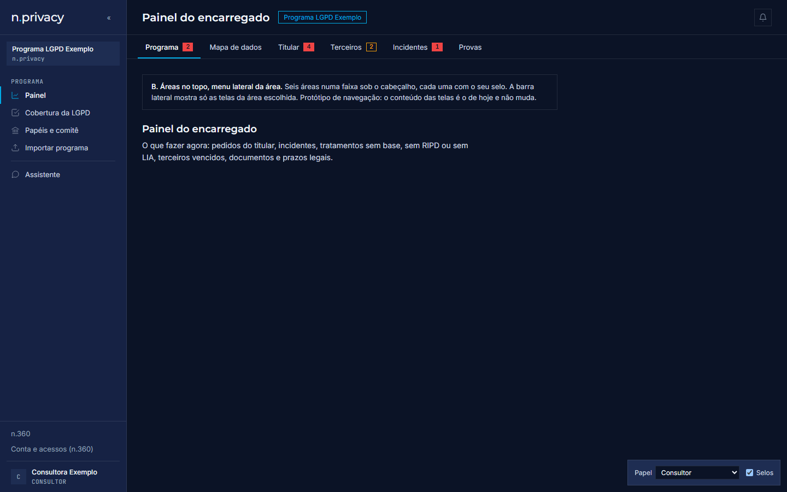 | 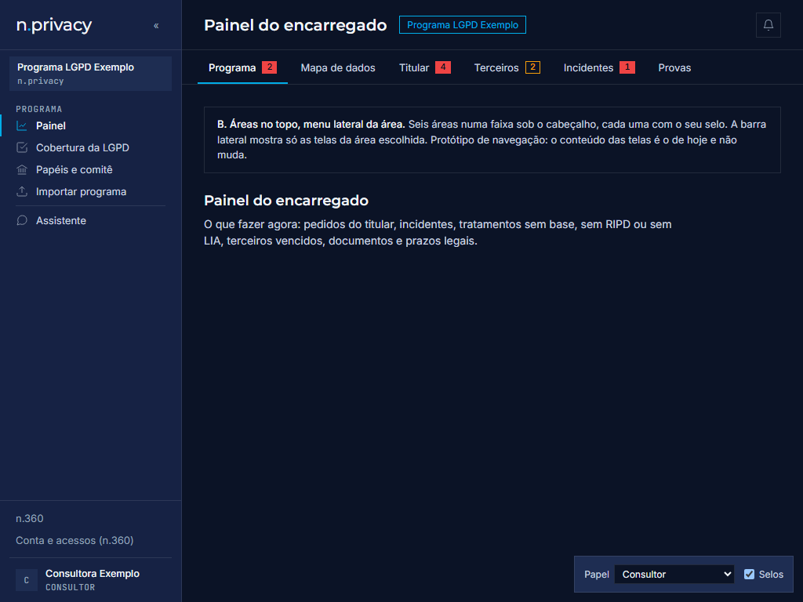 | 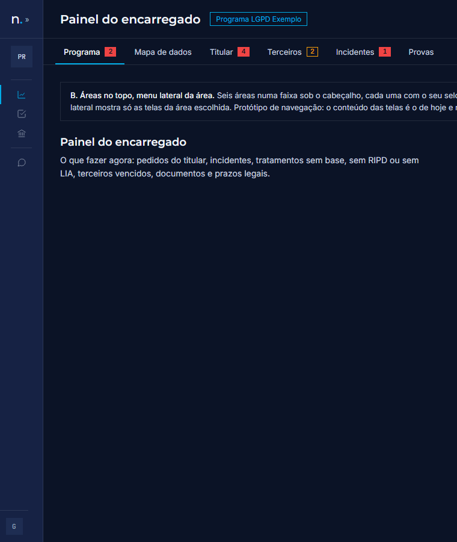 |

- Itens por nível: 6 áreas; 1 a 4 telas por área. Terceiros e Incidentes são áreas de uma tela só, e a barra
  lateral fica com um item, o que mostra que o produto não tem tamanho para dois eixos.
- Selos nas áreas. Prazos legais ganha entrada (área Titular).
- Custo: alto. Cabeçalho novo só no n.privacy (o cabeçalho é da casca comum), mapa tela → área no router, barra
  lateral montada por área, `?tela=` e avisos do sino que precisam abrir a área certa, e todos os testes de menu.
- Risco: médio a alto. Dois eixos de navegação, 44px a menos de altura útil em toda tela, e a casca do n.privacy
  fica diferente da do n.iso e do n.360 (a pessoa que usa os dois módulos troca de modelo mental).
- Para quem já usa: muda tudo. É o modelo de suítes grandes (vários produtos com menu próprio), que o n.privacy
  não é.

### C. O painel como casa, menu de seis áreas

[Protótipo](menu-privacy/alternativa-c-casa.html)

Seis entradas (Painel, Tratamentos, Titular, Terceiros, Incidentes, Provas) mais Assistente e Importar programa.
Cada área vira uma tela com abas: Tratamentos (RoPA, RIPD, Pessoas áreas e sistemas), Titular (Pedidos,
Consentimentos, Prazos legais), Provas (Documentos, Evidências, Treinamento, Papéis e comitê), Painel (O que fazer,
Cobertura da LGPD). O painel ganha um cartão por área.

| 1440x900 | 1024x768 | Cliente, barra recolhida |
|---|---|---|
| 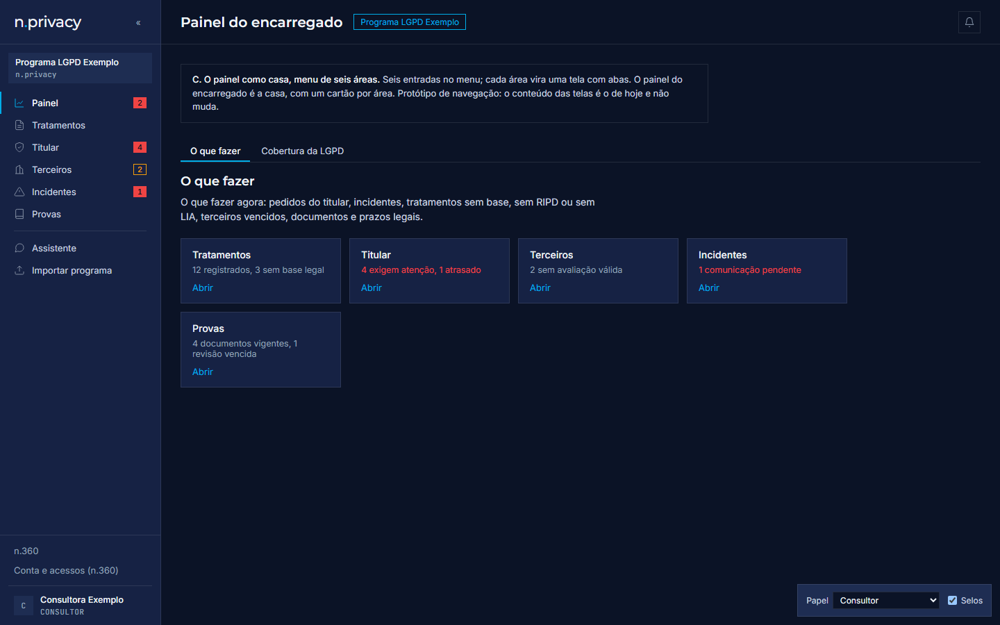 | 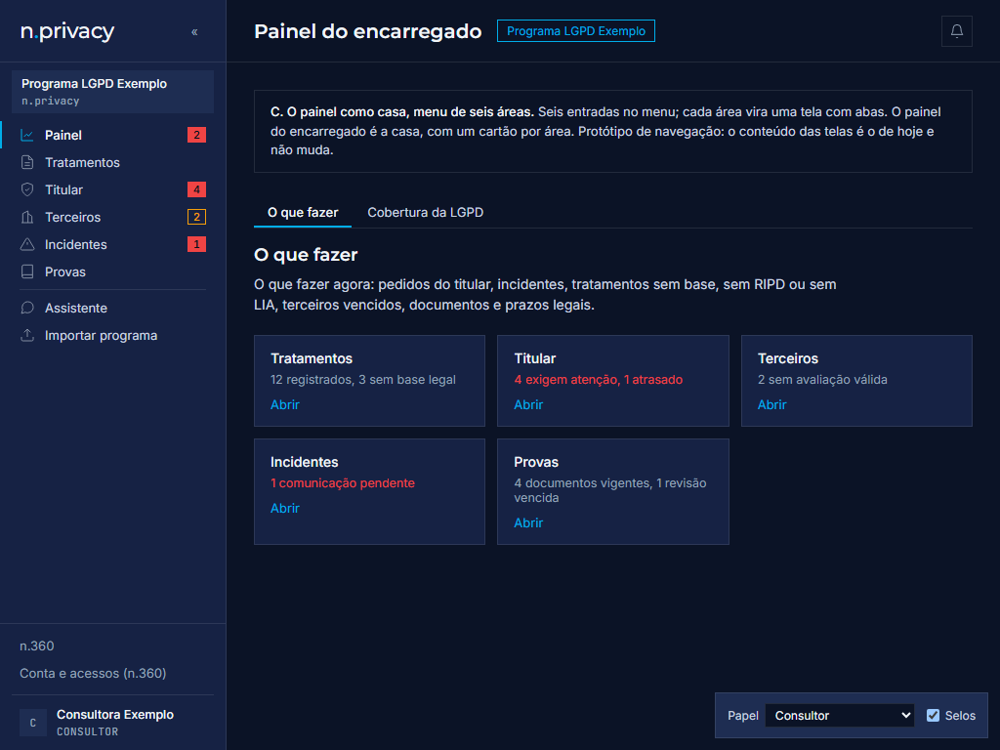 | 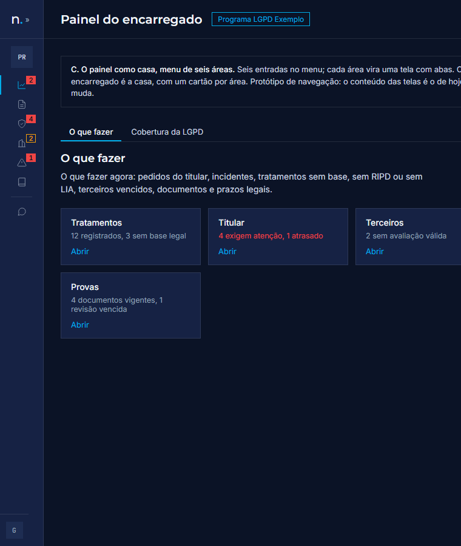 |

- Itens por nível: 6 (+2 utilitários). É o menu mais curto e o que melhor funciona recolhido.
- Selos: Painel, Titular, Terceiros, Incidentes.
- Custo: médio a alto. Além do que A pede, cada área precisa de uma tela com abas que monte as telas de hoje
  (`documentos`, `evidence`, `training`, `governance`, `ropa`, `dpia`, `partes`, `requisitos`), com aba no
  endereço para o sino, o `?tela=` e o voltar do navegador. Testes de cada tela que hoje é aberta pelo menu.
- Risco: médio. Profundidade maior (Evidências passa a 2 cliques: Provas e a aba), e telas do cadastro comum
  (Documentos, Partes) ganham um "pai" que no n.iso não existe.
- Para quem já usa: menu bem menor; quem ia direto a Evidências passa a ir por Provas.

### Comparação

| | Hoje | A | B | C |
|---|---|---|---|---|
| Opções no 1º nível (consultor) | 10 | 15 itens em 4 seções, 0 grupos | 6 áreas + 1 a 4 itens | 8 |
| Destinos visíveis sem clicar | 9 de 15 | 15 de 15 | 5 a 7 | 8, o resto em abas |
| Cliques RoPA → Documentos | 2 | 1 | 2 | 2 |
| Cliques painel → Consentimentos | 2 | 1 | 2 | 2 |
| Paradas de Tab invisíveis | 7 | 0 | 0 | 0 |
| Rótulos em 2 linhas | 2 | 0 | 0 | 0 |
| Links com nome na barra recolhida | 0 | todos | todos | todos |
| Muda o n.iso ou o n.360 | | não | o cabeçalho, só no n.privacy | não |
| Custo | | baixo a médio | alto | médio a alto |

## 6. Recomendação: A

A resolve os quatro P1 com o menor custo e sem mexer no n.iso nem no n.360. Ela troca o "o que é urgente / o resto
em gavetas" por uma lista curta e inteira, na ordem do programa, com nomes de objeto e com os selos dizendo o que
contam. O que o dono sente como "ainda não é adequado" vem, pelo diagnóstico, de esconder (acordeão, rail sem nome,
abas sem entrada) e de misturar critérios; A ataca os dois. C é a evolução natural se o programa crescer além de
~16 telas: as seções de A viram as áreas de C sem trocar nomes.

### Plano em fases

1. **Fase 1, rótulos e selos (1 PR pequeno).** `ROTULOS_PRIVACY` com os nomes de uma linha; selo preenchido no
   atraso e selo do painel (`selos-menu.js`, `style.css`); correção do `nav-audit-trail` no `router.js`; ativo
   acompanhando a aba de Titular (`globals.js`). Testes: `selos-menu.test.js`, `casca-menu.test.js` (rótulos), um
   caso novo no router. Risco baixo.
2. **Fase 2, seções fixas (1 PR).** `organizarMenuPrivacy` monta Mapear, Avaliar, Responder e Provar como títulos
   não clicáveis, com `ul`/`li`; `nav-consentimentos` em `login.html` e `SO_PRIVACY`; Meus pedidos e Trilha de logs
   para o menu de conta no n.privacy. Testes: `casca-menu.test.js` (ordem, seções, nada recolhível no n.privacy, o
   n.iso igual), `frontend/e2e/n360.spec.js` (troca dos dois textos de grupo). Risco: o e2e e os testes do n.iso
   precisam provar que o acordeão do n.iso não mudou.
3. **Fase 3, barra recolhida acessível (1 PR, só n.privacy ou para os três se o dono quiser).** Texto
   visualmente escondido no lugar de `display: none`, tooltip ao passar e ao focar, selo no canto do ícone, ícones
   distintos. Teste: casca-menu (nome acessível com a barra recolhida) e um e2e com `getByRole('link', { name })`.
4. **Fase 4, opcional.** Itens como `<a href>` com o endereço da tela (abre em nova aba). Toca a delegação de
   eventos e o router; vale para os três produtos, então é decisão à parte.

### Medida de sucesso (verificável no navegador, papel consultor, 1440x900 e 1024x768)

- 15 de 15 destinos visíveis sem clicar (hoje 9).
- 0 paradas de Tab em item invisível (hoje 7 de 23).
- 0 rótulos em duas linhas (hoje 2).
- 1 clique de RoPA a Documentos e do painel a Consentimentos (hoje 2 e 2).
- Barra recolhida: todo link do menu com nome acessível (hoje 0).
- Conteúdo da barra cabe a 1024x768 sem rolagem do menu, ou com no máximo 1 item abaixo da dobra.
- Selo: quem enxerga distingue "pendente" de "atrasado" sem depender só da cor (fundo cheio contra contorno), e
  todo selo passa de 4,5:1 (hoje o vermelho fica em 4,14:1).

Os números de hoje saem de [`atual/inventario-menu.json`](menu-privacy/atual/inventario-menu.json) e do teste de Tab
descrito na seção 3.1; o mesmo roteiro serve para medir depois.

## 7. Decisões do dono

1. Qual alternativa (recomendação: A; C como passo seguinte se o produto crescer).
2. Nomes: "Painel" (hoje "Encarregado"), "Tratamentos (RoPA)", "Pessoas, áreas e sistemas", "Cobertura da LGPD",
   "Papéis e comitê", "Pedidos do titular" sem "(DSAR)". Rótulo de tela muda só no n.privacy?
3. Consentimentos ganha item no menu (A) ou continua aba de Titular?
4. "Meus pedidos" e "Trilha de logs" saem do menu do módulo para o menu de conta? (Os dois continuam no n.360.)
5. O selo deve contar o total que exige atenção (hoje) ou só os atrasados? E o cliente deveria ver um selo em
   "Minhas aprovações" (o que espera a decisão dele)?
6. As correções de acessibilidade da barra (Tab em grupo fechado, rail sem nome) valem também para o n.iso e o
   n.360? Elas são defeito nos três, mas o pedido foi não mexer no menu deles.
7. Itens como `<a href>` (abrir em nova aba): entra agora ou fica para depois?
